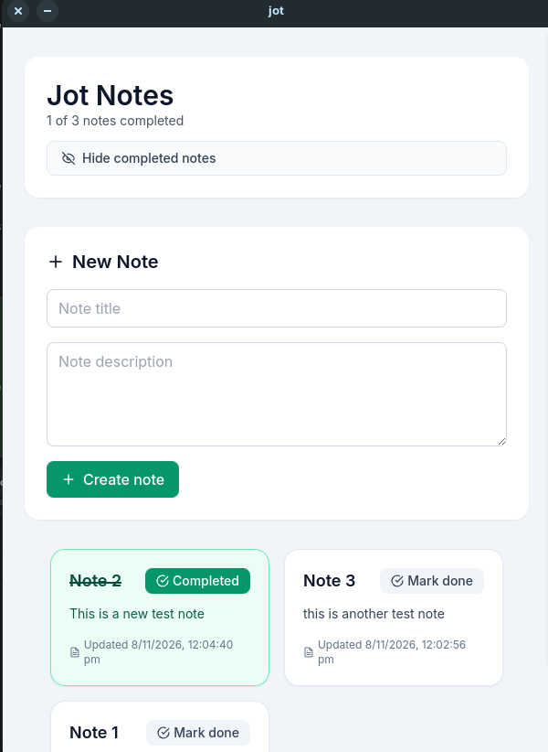
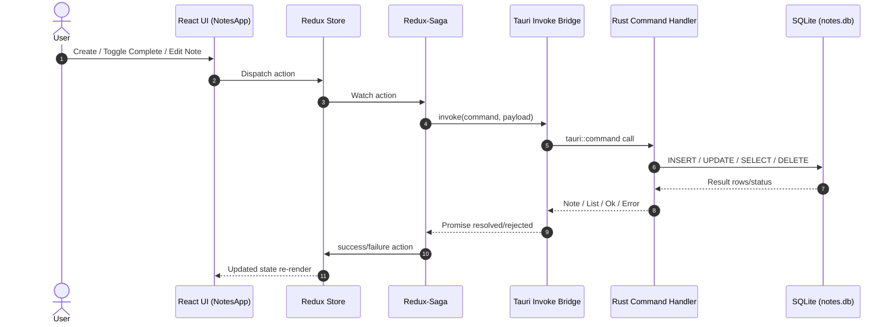
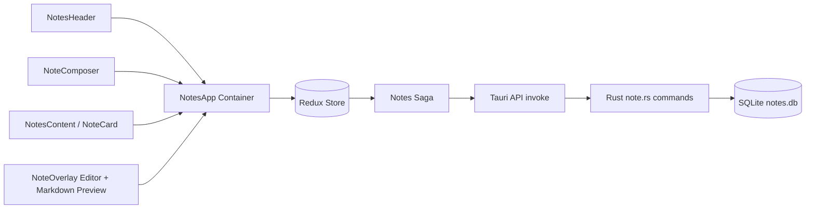

# Jot

Jot is a desktop notes app built with **Tauri + React + TypeScript + Rust + SQLite**.

It supports:
- Creating notes
- Listing notes in fixed-size cards (grid)
- Marking notes complete/incomplete
- Hiding/showing **completed** notes
- Opening a full-screen overlay to edit note title/content
- Markdown editing with live preview
- Persisting notes in SQLite and loading them at startup

---

## Screenshots

### Notes grid and composer



---

## Tech Stack

| Layer | Technology |
|---|---|
| Desktop shell | Tauri 2 |
| Frontend | React 19, TypeScript, Tailwind CSS |
| State management | Redux Toolkit + Redux-Saga |
| Icons/Markdown | react-icons, react-markdown |
| Backend | Rust |
| Persistence | SQLite via rusqlite (`bundled`) |
| Frontend tests | Vitest + Testing Library |
| Backend tests | Rust unit tests |

---

## Architecture Overview

### Frontend flow
- UI components dispatch Redux actions.
- Redux-Saga handles side effects (Tauri command invocations).
- Results are reduced into Redux state and reflected in UI.

### Backend flow
- Tauri commands in Rust (`create_note`, `list_notes`, `get_note`, `update_note`, `delete_note`).
- Shared in-memory note store guarded by `Mutex`.
- Every create/update/delete operation is persisted to SQLite.
- On app startup, notes are loaded from SQLite into store.

---

## Request Flow (UML Sequence)



---

## Component Diagram (High-level)



---

## Project Structure

```text
jot/
├─ src/
│  ├─ App.tsx
│  ├─ main.tsx
│  ├─ index.css
│  ├─ store/
│  │  ├─ index.ts
│  │  └─ hooks.ts
│  └─ features/notes/
│     ├─ NotesApp.tsx
│     ├─ noteApi.ts
│     ├─ notesSlice.ts
│     ├─ notesSaga.ts
│     ├─ types.ts
│     ├─ NotesApp.test.tsx
│     └─ components/
│        ├─ NotesHeader.tsx
│        ├─ NoteComposer.tsx
│        ├─ NotesContent.tsx
│        ├─ NoteCard.tsx
│        └─ NoteOverlay.tsx
└─ src-tauri/
   ├─ src/
   │  ├─ lib.rs
   │  └─ note.rs
   ├─ tauri.conf.json
   └─ Cargo.toml
```

---

## Running the App

### Prerequisites
- Node.js + pnpm
- Rust toolchain
- Tauri prerequisites for your OS

### Install dependencies

```bash
pnpm install
```

### Run in development

```bash
pnpm tauri dev
```

### Build

```bash
pnpm tauri build
```

---

## Testing

### Frontend tests

```bash
pnpm test
```

### Rust tests

```bash
cd src-tauri
cargo test --lib
```

If your Linux environment cannot find GTK/WebKit pkg-config files, set:

```bash
export PKG_CONFIG_PATH="/usr/lib/x86_64-linux-gnu/pkgconfig:$PKG_CONFIG_PATH"
```

---

## Data Model

`Note` fields:
- `id: String`
- `title: String`
- `content: String`
- `completed: bool`
- `created_at: String` (RFC3339)
- `updated_at: String` (RFC3339)

SQLite table: `notes` in app data directory (`notes.db`).
